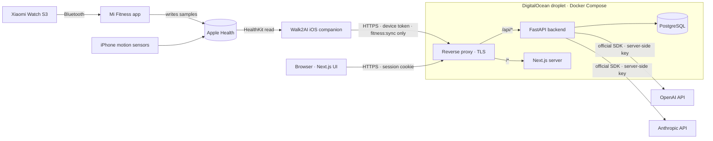

# Walk2AI — Architecture

> Status: **Architecture approved on 2026-11-13.** Phases 1 and 2 are implemented: the
> backend foundation, authentication, device pairing, the wallet, fitness ingestion, the
> reward engine and spending limits (sections 4, 6, 7, 9, 10 and 11). The AI gateway,
> frontend and companion are designs not yet built —
> [PROJECT_STATUS.md](../PROJECT_STATUS.md) says exactly what exists. Decisions are
> recorded in [DECISIONS.md](DECISIONS.md).

## 1. What the system does

```
Physical activity → verified activity data → Walk Credits → AI allowance → AI requests
```

Walk2AI is a personal platform with two halves joined by a wallet:

- **Earning side.** A small iOS companion reads Apple HealthKit and pushes raw activity
  facts to the backend. The backend validates them and the reward engine converts them
  into Walk Credits (WC).
- **Spending side.** A web app talks to OpenAI and Anthropic through one backend gateway.
  Every request must be covered by credits *before* it is sent, and is charged its real,
  provider-reported cost afterwards.

Walk Credits are an internal accounting unit. They are not money, not a prepaid provider
balance and not redeemable. Real provider charges still land on your OpenAI and Anthropic
accounts; Walk2AI's job is to make sure you never spend more there than you have earned.

## 2. System context



Trust boundaries, from least to most trusted:

| Zone | Contains | Trusted to |
|---|---|---|
| Phone | HealthKit data, a device token | Report raw activity facts. Never calculates rewards. |
| Browser | A session cookie | Ask for things. Never holds provider keys, never sets balances. |
| Backend | Provider keys, business rules | Validate everything, own all money logic. |
| Database | Ledger, constraints | Refuse impossible states even if the backend has a bug. |

## 3. Components

| Component | Technology | Responsibility |
|---|---|---|
| Web app | Next.js (App Router), React, TypeScript, Tailwind, shadcn/ui, Recharts | The main interface: dashboard, chat, activity, wallet, analytics, settings. Presentation only. |
| Backend API | Python, FastAPI, Pydantic, SQLAlchemy 2, Alembic | Auth, fitness ingestion, reward engine, wallet, AI gateway, analytics, admin. |
| Database | PostgreSQL 16 | System of record. Enforces ledger invariants with constraints. |
| iOS companion | SwiftUI, HealthKit, BackgroundTasks | Reads HealthKit, syncs to the backend, shows sync status. Nothing else. |
| Reverse proxy | Caddy | Automatic HTTPS, routing `/api` vs web, edge rate limiting, no response buffering for streams. |
| AI providers | Official `openai` and `anthropic` Python SDKs | Model inference. Called only by the backend. |

## 4. Backend structure

```
backend/app/
├── main.py            application factory, router registration, lifespan tasks
├── cli.py             seed · reconcile · expire-reservations
├── core/              config (pydantic-settings), db session, security, logging,
│                      middleware, rate limiting, error types, clock, timezones
├── models/            SQLAlchemy mapping (one module per aggregate)
├── schemas/           Pydantic request/response models
├── api/               thin routers: authorise → call a service → commit → serialise
└── services/
    ├── auth/          accounts, login sessions, device pairing        (built)
    ├── wallet/        the ONLY code that writes wallet tables         (built)
    ├── audit/         audit trail writer                              (built)
    ├── fitness/       sync ingestion, validation, de-duplication      (built)
    ├── rewards/       rule lookup, reward calculation, reward ledger  (built)
    ├── ai/            gateway, provider adapters, pricing, estimation (Phase 3)
    └── analytics/     read-only aggregations for the dashboards       (Phase 3)
```

Rules that keep the money logic honest:

1. **Routers contain no business logic.** They authorise, delegate to a service,
   commit, and serialise.
2. **`WalletService` is the single writer** of `wallet_accounts`, `wallet_transactions`
   and `wallet_reservations`. Every method locks the wallet row, changes the balance and
   appends the ledger row in one database transaction.
3. **Only `RewardEngine` creates `ACTIVITY_REWARD`**, and only via `WalletService`.
4. **Only `AIGateway` calls a provider**, and only while holding an active reservation.
5. **No provider call happens inside a database transaction.** Reserve → commit → call
   provider → settle in a new transaction. Row locks are held for milliseconds, never for
   the duration of a model response.
6. **Time is injected** (`Clock`) so token expiry, reservation expiry and day boundaries
   are deterministic under test.
7. **Services never commit; the caller owns the transaction.** A service method flushes
   inside the caller's transaction, so the reward engine and the AI gateway can compose
   several wallet operations into one atomic unit. The router commits once the whole
   operation has succeeded.

Rules 2, 6 and 7, and the ban on floating point in money code, are enforced by tests that
read the source (`tests/unit/test_architecture_rules.py`).

## 5. The credit economy

| Quantity | Type | Meaning |
|---|---|---|
| Walk Credits (WC) | integer | Internal unit. All balances and ledger amounts. |
| EUR→WC rate | versioned decimal | Initially `10000` (1,000 WC = €0.10, so 1 WC = €0.0001). |
| USD→EUR rate | versioned decimal | Admin-configured; converts provider billing to EUR. |
| Provider cost | `NUMERIC(18,8)` | Actual cost of a request in the provider's currency (USD). |

Rounding rules — fixed, documented, tested:

- **Earning rounds down.** `floor(rate × quantity)` on the day's total, never per sync.
- **Spending rounds up.** `credits = ceil(cost_eur × wc_per_eur)`, minimum 1 WC for any
  request that consumed tokens. The wallet can only ever err on the side of under-spending
  real money. Worst-case rounding loss is 1 WC (€0.0001) per request.
- All monetary arithmetic uses Python `Decimal` and PostgreSQL `NUMERIC`. No floats anywhere
  on a money path.

What the allowance buys (illustrative; uses the Anthropic list prices cached in the
`claude-api` reference on 2026-11-03, **to be re-verified in Phase 3**, and an assumed
USD→EUR rate of 0.92 — a request with 2,000 input and 1,000 output tokens):

| Model class | Approx. cost | Credits | Requests per max day (1,500 WC) |
|---|---|---|---|
| Small (Claude Haiku 5.5, $0.10 / $0.50 per MTok) | $0.0007 | 7 WC | ~210 |
| Mid (Claude Sonnet 5.5, $2 / $10) | $0.014 | 129 WC | ~11 |
| Large (Claude Opus 5.5, $4 / $20) | $0.028 | 258 WC | ~5 |

A full day of activity is worth €0.15. That is the intended constraint, but it means long
conversations on large models burn the allowance quickly because the whole history is
re-sent as input on every turn. The chat therefore needs a visible per-request estimate,
a configurable history window, and prompt caching where the provider supports it.

## 6. Reward engine

Formula from the specification, with the constants stored as versioned rules:

```
WC(day) = min( daily_cap, floor(r_steps × S) + floor(r_minutes × M) )
          r_steps = 0.1 WC/step   r_minutes = 5 WC/min   daily_cap = 1500 WC
```

- `S` — the day's step total from the canonical daily record.
- `M` — eligible active minutes from **non-step** workouts only. Walking, running and
  hiking are already paid through steps and contribute zero minutes
  (`workout_type_rules.category = 'step_based'`).

Algorithm, run for every `(user, activity_date)` touched by a sync, inside one transaction:

```
1. lock the wallet row                       (serialises earn + spend per user)
2. lock / create the daily_rewards row for the date
3. S = steps of the day's canonical record   (apple_healthkit; test data only if enabled)
4. M = eligible minutes:
       workouts that intersect the day and are verified, not deleted, not excluded,
       not flagged duplicate, category non_step;
       each clipped to the local day (user timezone) and to its own active duration;
       total = min( Σ clipped durations, length of the UNION of their intervals )
       → two overlapping workouts can never count the same minute twice
5. rules = the enabled rules whose date range contains the activity date
6. entitled = min(cap, min(limit_s, floor(r_s·S)) + min(limit_m, floor(r_m·M)))
7. delta = entitled − credits_awarded
     delta > 0 → WalletService.reward(+delta); credits_awarded = entitled
     delta ≤ 0 → nothing is paid
8. store S, M, entitled and a snapshot of the rules used
```

Properties:

- **Idempotent.** The engine pays the difference between what the day is worth and what
  the day has already been paid. Replaying a sync, or syncing the same day ten times,
  pays nothing extra. A unique idempotency key on the ledger row is the second lock.
- **Deterministic.** Same facts + same rules → same result. No dependence on sync order.
- **Late data works.** A day whose steps arrive tomorrow is recalculated and topped up,
  under that day's own cap and that day's own rules, up to `REWARD_WINDOW_DAYS` back.
- **Rule changes are never retroactive.** Rules are matched by *activity date*. A new
  rule can only start on a date that has not begun anywhere on Earth (the UTC date plus
  two days at the earliest); a rule whose range has begun cannot be edited — only
  closed (`effective_until`) and succeeded by a new row. The database rejects
  overlapping ranges.
- **Downward revisions do not claw back automatically.** HealthKit totals can shrink
  slightly when sources are re-merged. `credits_awarded` is a high-water mark: nothing is
  taken back, and nothing more is paid until the day's entitlement exceeds it again. An
  *explicit* exclusion of an already-rewarded workout posts a `REWARD_REVERSAL`, capped at
  the available balance (the wallet never goes negative).

### What a "day" is

The daily cap, daily spending limits and "today" in every summary refer to a calendar
day in the user's IANA timezone — `Europe/Lisbon` by default. Timestamps are stored in
UTC and converted only when a day boundary is needed, in one module
(`app/core/timeutil.py`). Daylight saving is handled by the timezone database, not by
arithmetic:

| Local day in Lisbon | Starts (UTC) | Ends (UTC) | Length |
|---|---|---|---|
| A winter day (WET, UTC+0) | 00:00 | 00:00 next day | 24 h |
| A summer day (WEST, UTC+1) | 23:00 previous day | 23:00 | 24 h |
| Last Sunday of March (clocks forward) | 00:00 | 23:00 | 23 h |
| Last Sunday of October (clocks back) | 23:00 previous day | 00:00 next day | 25 h |

So the cap resets at Portuguese midnight all year. A summer walk at 00:30 local time
belongs to the new day, although in UTC it is still 23:30 on the previous one.

## 7. Wallet

Two balances per user: `available` (spendable) and `reserved` (held for in-flight AI
requests). Every change is one immutable ledger row carrying both deltas:

| Transaction | `amount` (available) | `reserved_delta` | When |
|---|---|---|---|
| `ACTIVITY_REWARD` | +N | 0 | Reward engine pays a day's delta |
| `REWARD_REVERSAL` | −N | 0 | Explicitly excluded activity that was already paid |
| `CREDIT_RESERVATION` | −R | +R | Before an AI request is sent |
| `AI_USAGE` | 0 (or −overflow) | −C | Request finished; actual cost C charged from the hold |
| `CREDIT_RELEASE` | +(R−C) | −(R−C) | Unused part of the hold returned; or all of it on failure |
| `MANUAL_ADJUSTMENT` | ±N | 0 | Explicit, user-initiated funding (off by default) |
| `ADMIN_ADJUSTMENT` | ±N | 0 | Administrative correction, always audit-logged |

Invariants:

```
available ≥ 0 and reserved ≥ 0                     enforced by CHECK constraints
available = Σ amount, reserved = Σ reserved_delta   enforced by single-writer + reconciliation
ledger rows are never updated or deleted            enforced by triggers
one ledger row per idempotency key                  enforced by a unique index
```

Concurrency: every wallet operation begins with `SELECT … FOR UPDATE` on the user's wallet
row, and always in the same order (wallet row, then reservation row), so wallet operations
cannot deadlock each other. Two requests racing for the same credits are serialised by
PostgreSQL; the second one sees the first one's reservation and is refused.

This is tested with genuinely simultaneous transactions on separate connections: twenty
requests for 300 WC against 1,000 WC (exactly three succeed), concurrent settlement of
one reservation (charged once), settlement racing release and racing the expiry sweep,
fifteen simultaneous identical rewards (paid once), and a fixed-seed random workload
across several wallets. A negative-control test deliberately skips the lock and shows the
database's own `CHECK` constraint stopping the overdraft.

Settlement arithmetic, for a hold of R and an actual cost of C:

| Case | Charged | Released | Notes |
|---|---|---|---|
| C = 0 | 0 | R | Nothing was billable |
| 0 < C ≤ R | C | R − C | The normal case |
| C > R | R + min(C − R, available) | 0 | The excess comes from the available balance, never below zero; any remainder is reported as a shortfall |

## 8. AI gateway

One internal interface; provider differences stay inside adapters.

```python
class ProviderAdapter(Protocol):
    async def count_input_tokens(self, request: ChatRequest) -> TokenEstimate: ...
    def stream(self, request: ChatRequest) -> AsyncIterator[ProviderEvent]: ...
    # ProviderEvent = TextDelta | UsageReport | Completed | ProviderFailure
```

Each adapter normalises usage into one shape, because the providers count differently
(for example, whether cached tokens are included in the input-token figure):

```
NormalisedUsage(uncached_input, cache_read, cache_write, output, reasoning)
```

### Request lifecycle

```mermaid
sequenceDiagram
    participant UI as Web UI
    participant GW as AI gateway
    participant W as WalletService
    participant P as Provider

    UI->>GW: POST /ai/chat (session, model, max_output_tokens)
    GW->>GW: model enabled? verified price in force?
    GW->>GW: worst-case estimate = input tokens × price + max_output × price
    GW->>W: reserve(estimate) — checks limits + balance under row lock
    alt not enough credits / limit hit
        W-->>UI: 402 with reason; nothing sent to the provider
    else reserved
        W-->>GW: reservation
        GW->>P: request (streaming)
        P-->>UI: text deltas (SSE)
        P-->>GW: final usage
        GW->>GW: actual cost from provider usage × price version pinned at reservation
        GW->>W: settle(actual) — AI_USAGE + CREDIT_RELEASE in one transaction
        GW-->>UI: usage event: tokens, cost, credits charged, new balance
    end
```

### Outcome matrix

| Outcome | Charge | Usage record |
|---|---|---|
| Completed, provider reported usage | Actual cost | `succeeded`, `cost_basis = provider_usage` |
| Provider error before any output (4xx, 5xx, connection) | Nothing; full release | `failed` |
| Client disconnects mid-stream | Upstream is cancelled; charged on provider usage if received, otherwise a conservative estimate from the text produced | `cancelled`, basis marked `estimated` when it is |
| Timeout with partial output | As above | `timeout` |
| Timeout / crash with nothing known | Released; flagged for reconciliation against the provider's usage report | `unknown` |
| Actual cost above the reservation (should not happen: the hold is a worst case) | Charged from the hold, remainder from available but never below zero; anomaly logged | `succeeded` + anomaly |

A lifespan background task expires reservations that outlive their request (process crash),
so credits can never stay locked indefinitely.

### Pricing engine

- Prices live in `model_pricing`: per-million-token prices per category (input, output,
  cache read, cache write, optional long-prompt tier, anything else in `extra_prices`),
  with a currency, an effective range, a `verified` flag and the source URL.
- **A model is usable only while a verified price row covers the present moment.** No
  price, or an unverified one, means the model is listed as unavailable — a price is
  never invented.
- The price row and both conversion rates used for a request are pinned at reservation
  time and stored on the usage record, so every historical charge can be recomputed.

```
cost = ( uncached_input × input_price
       + cache_read     × cached_input_price
       + cache_write    × cache_write_price
       + output         × output_price ) / 1,000,000          (reasoning ⊂ output)
cost_eur = cost × usd_eur_rate
credits  = max(1, ceil(cost_eur × wc_per_eur))
```

### Model catalogue

`ai_models` is an admin-managed list. A model appears to the user only when it is
`enabled`, its availability has been confirmed against the provider's models endpoint
with *this* account's key, and it has a verified price. Capability flags
(`supports_temperature`, `supports_reasoning_effort`, `supports_streaming`) drive which
controls the UI shows; several current models reject sampling parameters outright, so
temperature is offered per model, not globally.

## 9. Spending controls

The user's own limits — all optional — are checked when credits are *reserved*, under the
wallet row lock, before anything is sent to a provider:

1. The balance covers the worst-case estimate (otherwise: *insufficient credits* — earn
   more; this is reported before any limit, so the user is not told to raise a limit
   when the wallet is simply empty).
2. Worst-case estimate ≤ per-request maximum.
3. Charged today + active holds + estimate ≤ daily maximum.
4. Charged this month + active holds + estimate ≤ monthly maximum.
5. `available − estimate ≥ minimum balance` (minimum balance ≥ 0; no negative balances).

From Phase 3 the gateway adds a check before these: the model is enabled and has a
verified price.

"Today" and "this month" are the user's own (Europe/Lisbon by default). Only the actual
cost of a finished request counts as spent; credits held for requests in flight count
until they settle, and a failed request gives its allowance back. Because the check runs
under the wallet lock, simultaneous requests cannot each slip under a limit that only one
of them fits (tested: ten concurrent 200 WC requests against a 500 WC daily limit, two
succeed).

A refusal is an HTTP 402 with a machine-readable code and a plain explanation: earn more
credits, or explicitly configure a funding adjustment. Nothing is ever topped up
automatically, and Walk2AI never touches provider billing settings.

**Hard backstop outside the application:** fund both provider accounts with a small
prepaid balance and keep auto-recharge off. Then even a bug in Walk2AI cannot produce a
bill larger than the prepaid amount. See [SECURITY.md](SECURITY.md#provider-side-controls).

## 10. Fitness ingestion

Detail and the device-side findings are in [FITNESS_INTEGRATION.md](FITNESS_INTEGRATION.md).
In short:

- The phone sends **facts** (daily totals from HealthKit statistics queries, workout
  records with their HealthKit UUIDs). It never sends credit amounts: the payload has no
  such field and unknown fields are rejected.
- One sync is one database transaction under the user's wallet lock, so syncs, rewards and
  spending for one user are serial.
- `POST /fitness/sync` is idempotent on a client batch id, upserts days on
  `(user, date, source)` and workouts on `(user, source, external_id)`.
- Every sync re-sends a rolling window of recent days, so late watch data and HealthKit
  corrections are reconciled without special cases.
- The server validates plausibility record by record (a rejected record never blocks the
  rest), links the same workout arriving under two ids, then runs the reward engine for
  each affected day.

The pipeline is source-agnostic by construction:

```
wire payload ──adapter──▶ SyncBatch(DayRecord…, WorkoutRecord…) ──▶ validation
                                                                      │
        source policy: which sources can earn, and which one is       ▼
        authoritative for a given day (never two summed)          storage ──▶ reward engine
```

An adapter turns one source's data into normalised records; a small source policy says
which sources may earn and which one is authoritative for a day. Adding Strava later is
a new adapter and a new entry in that policy — validation, de-duplication, the reward
engine and the wallet do not change. Test activity is simply another source
(`test`), allowed to earn only where it is explicitly enabled, and labelled in every
row and ledger entry it produces.

## 11. Authentication and authorisation

| Client | Credential | Scope |
|---|---|---|
| Browser | 15-minute access token + rotating 30-day refresh token, both in `HttpOnly`, `Secure` cookies (`SameSite=Lax` and `Strict`); the refresh cookie is sent only to `/api/v1/auth` | Everything the user's role allows |
| iOS companion | Long-lived device token (stored in the iOS Keychain, hashed in the database, revocable) | `fitness:sync` only |
| Admin | Same as browser, `role = admin` | Plus `/admin/*` |

The web app and API share one origin behind the reverse proxy (`/` and `/api`), so there
is no cross-origin token handling. The phone is paired by entering a one-time code shown
in the web app's settings; that exchange is the only time it sees a credential.

A login creates a *login session* — a family of refresh tokens. The access token is a
signed JWT, but it is honoured only while its login session is alive in the database, and
the user's role and status are read on every request. Logout, password change, suspension
and role changes therefore take effect immediately rather than when a token expires.
Presenting a refresh token that has already been rotated is treated as theft: the whole
login session is revoked.

Registration defaults to `first_user_only`: the first account becomes the admin and
registration then closes. This is a personal platform; it should not accept strangers.

## 12. Frontend

- App Router with an authenticated shell (sidebar: Dashboard, AI Chat, Activity, Wallet,
  Usage Analytics, Settings) and a public login page.
- Server state through TanStack Query against the REST API; no client-side copies of
  balances beyond the query cache. The wallet figure is always the server's.
- Chat streaming via `fetch` + `ReadableStream` over Server-Sent Events.
- Markdown with GFM and syntax highlighting for assistant messages.
- TypeScript types generated from the backend's OpenAPI schema, so the two cannot drift.
- No mock data: every figure on screen comes from an endpoint.

## 13. Deployment topology

| | Development | Production (Phase 6) |
|---|---|---|
| Database | `docker compose up db` (or a local PostgreSQL 16) | PostgreSQL container on the droplet with nightly encrypted off-box backups, or DigitalOcean Managed PostgreSQL |
| Backend | `docker compose up` (container, non-root) on :8000; migrations and seed run first as a one-shot service | Same image; migrations run as a release step |
| Frontend | `next dev` on :3000, proxying `/api` to :8000 | Container (standalone build) |
| TLS | none (localhost) | Caddy, with automatic certificates |
| Secrets | `.env` (git-ignored) | Environment file on the server with `600` permissions, outside the repository |

## 14. Technology evaluation

The proposed stack is sound; the changes are small and reduce moving parts.

| Area | Decision | Why |
|---|---|---|
| Backend | Keep FastAPI + Pydantic + SQLAlchemy 2 + Alembic | Async streaming to providers, strong typing, mature migrations. |
| DB driver | psycopg 3 | One driver for async app code and sync Alembic. |
| Database | Keep PostgreSQL 16 | Row locks, exclusion constraints and `NUMERIC` are exactly what a ledger needs. |
| Auth / DB hosting | **Not Supabase** (approved) — own PostgreSQL, first-party auth in FastAPI | One user, one server. Supabase would split auth across two systems, add an external dependency and a second place where balances could be reached. Standard Postgres keeps the option open later. |
| Queue / cache | **None in the MVP** (no Redis, no Celery) | One process, one user. In-process background task for expiring reservations; PostgreSQL for everything stateful. |
| Frontend | Keep Next.js + Tailwind + shadcn/ui + Recharts | shadcn's chart components are built on Recharts. |
| Reverse proxy | **Caddy** (approved) | Automatic HTTPS with a five-line config; fewer ways to misconfigure TLS. |
| iOS | Keep SwiftUI + HealthKit | The only way to read Apple Health natively. No Mac is available and no purchase is approved, so the build route is investigated before Phase 5 (D-07). |
| OpenAI API surface | Responses API via the official SDK (confirm in Phase 3) | The current primary API; reports usage on streamed responses. |
| Anthropic API surface | Messages API via the official SDK | Token counting endpoint for exact pre-request estimates. |

Versions verified on 2026-11-13 are listed in [DEVELOPMENT.md](DEVELOPMENT.md#toolchain).

## 15. Deliberately out of scope for the MVP

- Multiple users with separate provider keys, teams, sharing.
- Tool use, file uploads, image input, web search (each adds billable categories).
- Automatic exchange-rate feeds (the rate is an admin setting; a feed can be added later).
- Push notifications; spending alerts are in-app first.
- Android / Health Connect.
- Any automatic purchase of provider credit — permanently out of scope.
