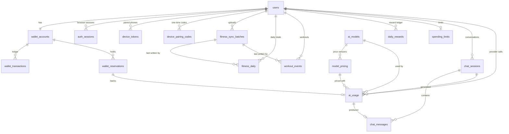

# Walk2AI — Database Design

> Status: **Implemented.** Phase 2 needed no schema change: the fitness and reward tables
> created in Phase 1 are now in use. The schema is created by the Alembic migration
> `backend/migrations/versions/0001_initial_schema.py`, which is the source of truth.
> [`database/schema.sql`](database/schema.sql) is generated from a migrated database for
> reading (`make schema-doc`). The guarantees below are covered by automated tests
> (see [Validation](#validation)).

## Principles

| Principle | How it is applied |
|---|---|
| Credits are integers | `BIGINT` / `INTEGER` for every WC amount. |
| Money is decimal | `NUMERIC(18,8)` for prices, costs and exchange rates. No `REAL` / `DOUBLE` in the schema. |
| The ledger is immutable | `wallet_transactions` and `audit_log` reject `UPDATE`, `DELETE` and `TRUNCATE` by trigger. |
| Impossible states are unrepresentable | `CHECK` constraints for non-negative balances and transaction shapes; `EXCLUDE` constraints so versioned rows cannot overlap. |
| History is never rewritten | Rules, prices and rates are versioned by effective range. Each usage record stores the price row and rates it was charged with. |
| Idempotency is structural | Unique keys on sync batches, workouts, daily records, reward days, reservations, usage records and ledger idempotency keys. |
| Time | `TIMESTAMPTZ` in UTC. Activity dates are `DATE` in the user's local calendar. |
| Enumerations | `TEXT` + `CHECK`, not native enums (simpler migrations). |

## Entity overview



Standalone configuration tables: `reward_rules`, `workout_type_rules`, `exchange_rates`.
Standalone log: `audit_log`.

## Tables

Twenty-one tables. Twelve are the ones named in the specification; nine are additions,
each justified below. The AI tables exist now but are only written to from Phase 3.

### Identity and access

| Table | Purpose | Notes |
|---|---|---|
| `users` | Accounts | Spec columns plus `password_hash` (Argon2id), `role`, `timezone` (defines the user's "day"), `display_name`, `updated_at`. E-mail is `CITEXT` and unique. |
| `auth_sessions` *(added)* | Browser refresh tokens | Only a SHA-256 hash is stored. Tokens from one login share a `family_id`; rotation links via `rotated_from`; `revoked_reason` distinguishes rotation, logout, password change and detected reuse. |
| `device_tokens` *(added)* | iOS companion credentials | Hashed, revocable, scoped (`fitness:sync`). Supports "disconnect fitness integration". |
| `device_pairing_codes` *(added)* | One-time codes that a new device exchanges for a token | Stored as an HMAC keyed with the server secret; short-lived; single-use. |

### Fitness

| Table | Purpose | Notes |
|---|---|---|
| `fitness_sync_batches` *(added)* | One row per sync call | `UNIQUE (user_id, client_batch_id)` makes `POST /fitness/sync` idempotent. Stores a payload hash and the result returned. |
| `fitness_daily` | Daily totals | `UNIQUE (user_id, activity_date, source)`. A re-sync overwrites the day. `active_minutes` is computed by the server, not accepted from the device. Distances are stored in metres. |
| `workout_events` | Workout records | `UNIQUE (user_id, source, external_id)` where `external_id` is the HealthKit UUID. Adds `excluded_from_rewards`, `duplicate_of`, `deleted_at`, `was_user_entered`, origin app/device. |
| `workout_type_rules` *(added)* | Workout type → `step_based` / `non_step` / `excluded` | Makes "walking and running earn through steps only" configurable rather than hard-coded. |

`source` is one of `apple_healthkit`, `test`, `manual`. Rows from the `test` source are
forced to carry `is_test_data = true` by a `CHECK`, so test data cannot be mistaken for
real activity anywhere downstream.

### Rewards

| Table | Purpose | Notes |
|---|---|---|
| `reward_rules` | Versioned reward parameters | Spec columns. `activity_type` ∈ `steps`, `workout_minutes`, `daily_total`. The `daily_total` row carries the 1,500 WC cap in `daily_limit` and has no rate. Overlapping enabled ranges for the same type are rejected by an `EXCLUDE` constraint. |
| `daily_rewards` *(added)* | Reward ledger, one row per user per day | Holds what the day is worth (`entitled_credits`), what has been paid (`credits_awarded`) and a snapshot of the rules used. This is what makes the engine idempotent. |

Seed rules for the initial configuration (inserted by a seed command in Phase 2, never
hard-coded in the engine):

| `activity_type` | `conversion_rate` | `daily_limit` | Meaning |
|---|---|---|---|
| `steps` | 0.1 | — | 1,000 steps = 100 WC |
| `workout_minutes` | 5 | — | 30 minutes = 150 WC |
| `daily_total` | — | 1500 | Daily maximum |

### Wallet

| Table | Purpose | Notes |
|---|---|---|
| `wallet_accounts` | Balances | Spec columns. `CHECK (available_balance >= 0)`, `CHECK (reserved_balance >= 0)`. |
| `wallet_transactions` | Immutable ledger | Spec columns plus `reserved_delta`, `reserved_after`, `reference_type`, `idempotency_key`, `metadata`. `BIGINT` identity key gives a strict order. A `CHECK` enforces the shape of each transaction type. |
| `wallet_reservations` | Holds for in-flight AI requests | Spec columns plus `settled_amount`, `released_amount`, `description`, `closed_at`. `request_id` is unique. |
| `spending_limits` *(added)* | Per-user spending controls | Per-request, daily and monthly maxima, minimum balance, alert threshold. |

Transaction shapes enforced by `ck_wallet_tx_shape`:

| Type | `amount` | `reserved_delta` |
|---|---|---|
| `ACTIVITY_REWARD` | > 0 | 0 |
| `REWARD_REVERSAL` *(added type)* | < 0 | 0 |
| `CREDIT_RESERVATION` | < 0 | = −amount |
| `CREDIT_RELEASE` | > 0 | = −amount |
| `AI_USAGE` | ≤ 0 | ≤ 0, and the two sum to < 0 |
| `MANUAL_ADJUSTMENT`, `ADMIN_ADJUSTMENT` | ≠ 0 | 0 |

### AI

| Table | Purpose | Notes |
|---|---|---|
| `ai_models` | Administrable model catalogue | Spec columns plus capability flags, `max_output_tokens`, `availability_checked_at`. New models are `enabled = false` until verified. |
| `model_pricing` | Versioned prices per million tokens | Spec columns plus cache-write prices, an optional long-prompt tier, `extra_prices`, `effective_until`, `verified`, `verified_at`, `source_url`. A verified row must cite its source. Overlapping ranges per model are rejected. |
| `exchange_rates` *(added)* | Versioned conversion rates | `USD→EUR` for provider billing and `EUR→WC` (10000) for the credit economy, in one table with one mechanism. |
| `chat_sessions` | Conversations | Spec columns plus `model_id`. |
| `chat_messages` | Messages | Spec columns plus `status` and a link to the usage record that produced an assistant message. |
| `ai_usage` | Financial record of every provider call | Spec columns plus `request_id`, `reservation_id`, `pricing_id`, cache-write and reasoning tokens, estimate, currency, both rates used, EUR cost, `cost_basis`, provider request id, error fields. |

Deleting a conversation removes its messages but **not** its usage records
(`ai_usage.session_id` is set to `NULL`). Content is the user's to delete; the financial
record is not.

### Audit

| Table | Purpose |
|---|---|
| `audit_log` *(added)* | Append-only record of logins, admin changes, rule and price edits, wallet adjustments, device pairing and data deletion. Never contains secrets or message content. A trigger rejects every change except one: detaching the actor when a user row is deleted. |

### Deletion rules

| Deleting… | Effect |
|---|---|
| A user with wallet history | Refused (`RESTRICT`). Accounts are suspended, not erased. |
| An admin who authored an adjustment | Refused: the ledger row naming them cannot be rewritten. |
| A user without wallet history | Sessions, devices and fitness data cascade; audit rows remain with the actor detached. |
| A conversation | Messages go; usage records stay with `session_id` set to `NULL`. |

## Invariants and where they are enforced

| Invariant | Enforced by |
|---|---|
| A balance is never negative | `CHECK` on `wallet_accounts` |
| Ledger rows are never changed | Triggers on `wallet_transactions` |
| A ledger operation cannot be applied twice | Partial unique index on `(user_id, idempotency_key)` |
| One hold per AI request | `UNIQUE (request_id)` on `wallet_reservations` and `ai_usage` |
| A day is rewarded through one ledger row | `UNIQUE (user_id, activity_date)` on `daily_rewards` |
| A workout exists once | `UNIQUE (user_id, source, external_id)` |
| A sync batch is processed once | `UNIQUE (user_id, client_batch_id)` |
| Exactly one rule / price / rate applies at any moment | `EXCLUDE USING gist` on the effective ranges |
| A verified price cites its source | `CHECK` on `model_pricing` |
| Balances equal the sum of the ledger | `WalletService` as single writer; asserted after every test; reconciliation check available to the admin |

The last row is the only invariant the database does not enforce on its own. It is
guaranteed by construction (one service writes both sides in one transaction) and
verified continuously rather than assumed.

## Versioned configuration: how a change works

To change the step rate from 0.1 to 0.2 starting 1 June:

```sql
BEGIN;
UPDATE reward_rules SET effective_until = '2026-06-01'
 WHERE activity_type = 'steps' AND effective_until IS NULL;
INSERT INTO reward_rules (activity_type, conversion_rate, effective_from)
VALUES ('steps', 0.2, '2026-06-01');
COMMIT;
```

Activity dated 31 May is still calculated at 0.1, forever. The admin API performs exactly
this close-and-succeed operation; it does not offer a way to edit a rate in place once its
range has started. Prices and exchange rates work the same way with timestamps.

## Indexing

Indexes exist for the access paths the application actually has: history by user and
time (`fitness_daily`, `workout_events`, `wallet_transactions`, `ai_usage`,
`chat_sessions`), active holds by expiry, ledger lookup by reference, audit by entity.
Analytics for a single user over months of data is small; no materialised views are
planned until measurements show a need.

## Migrations

- Alembic, one linear history. **The migrations are the schema**: they are hand-written
  SQL, because the parts that matter most here (`CHECK` and `EXCLUDE` constraints,
  triggers) are the parts autogeneration does not understand.
- The SQLAlchemy models are the *mapping* onto that schema. A test compares the two and
  fails on any difference in tables, columns, types, keys, unique constraints or indexes.
- Every constraint and index has an explicit, stable name (`ck_…`, `uq_…`, `ix_…`,
  `fk_…`, `ex_…`), so errors, tests and later migrations can refer to them.
- The downgrade is tested: upgrade → downgrade → upgrade on an empty database.
  Production only moves forward.
- Tests always build their database by running the migrations, never `create_all()`.
- Seed data (reward rules, workout type rules, the EUR→WC rate) is applied by an explicit,
  idempotent command (`python -m app.cli seed`) that never overwrites existing values.

## Validation

Every guarantee on this page is exercised by the automated test-suite, against a real
PostgreSQL built by the real migrations.

| Guarantee | Where it is tested |
|---|---|
| Migration applies, reverts and re-applies on an empty database | `tests/test_migrations.py` |
| Models and schema agree exactly | `tests/test_migrations.py` |
| Triggers and exclusion constraints exist; no floating-point or timezone-naive column anywhere | `tests/test_migrations.py` |
| Ledger rejects `UPDATE`, `DELETE`, `TRUNCATE`; audit log likewise | `tests/test_schema_integrity.py` |
| Negative balances, malformed ledger rows (14 shapes), reused idempotency keys are refused | `tests/test_schema_integrity.py` |
| Rule, price and rate versions cannot overlap; a verified price cites its source | `tests/test_schema_integrity.py` |
| Test fitness data is always labelled; a day, a workout and a reward day exist once | `tests/test_schema_integrity.py` |
| The specification's wallet example ends at exactly 3,300 WC | `tests/test_wallet_service.py` |
| Concurrent spending cannot overdraw; the database stops it even without the lock | `tests/test_wallet_concurrency.py` |
| A tampered balance is detected by reconciliation | `tests/test_wallet_service.py`, `tests/test_admin_api.py` |

The checks were also repeated by hand against the running Docker Compose stack: an
`UPDATE` and a `DELETE` on the ledger and a negative balance were each refused by the
live database.
